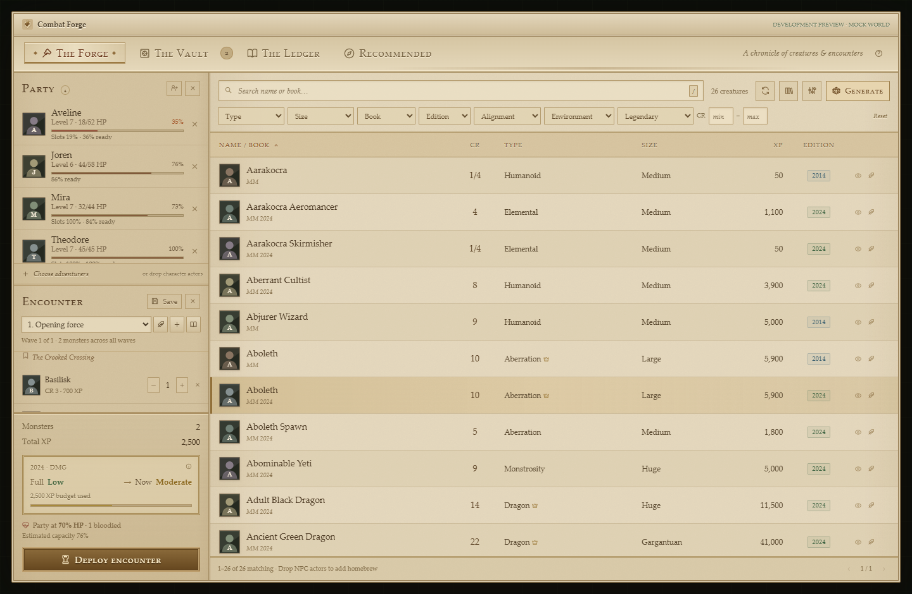
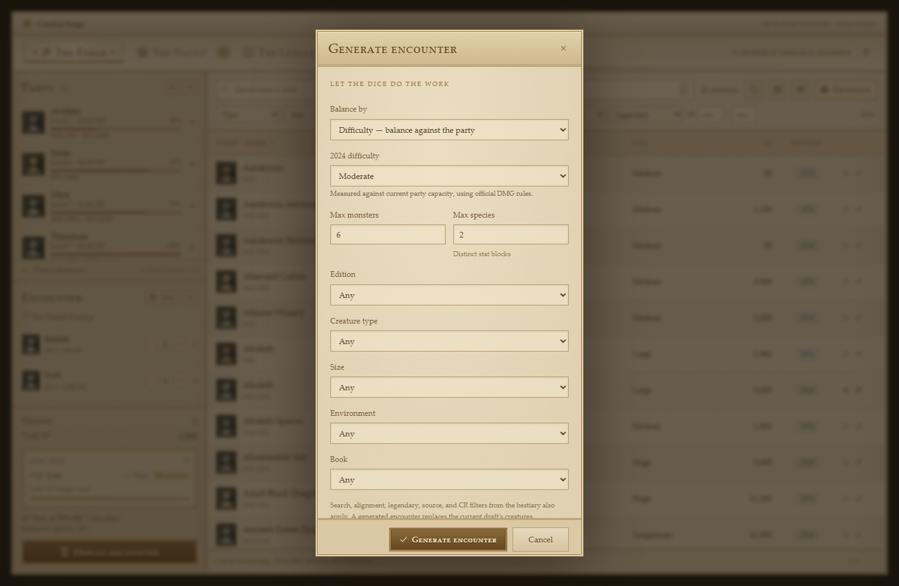
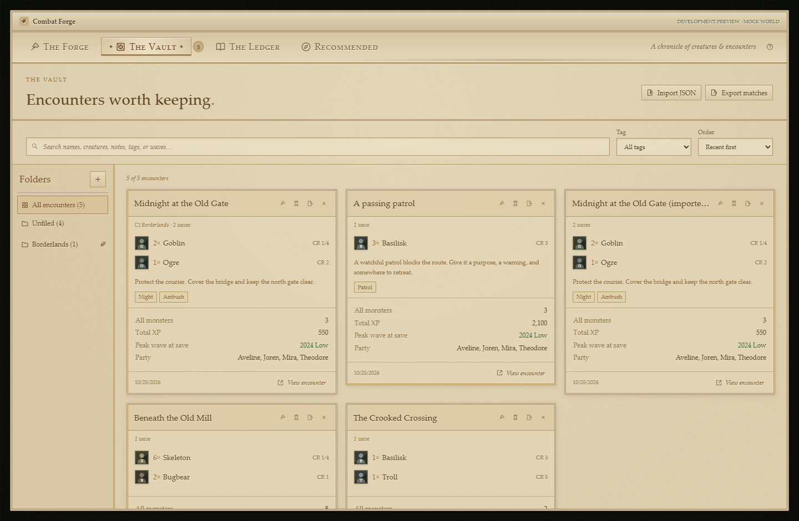
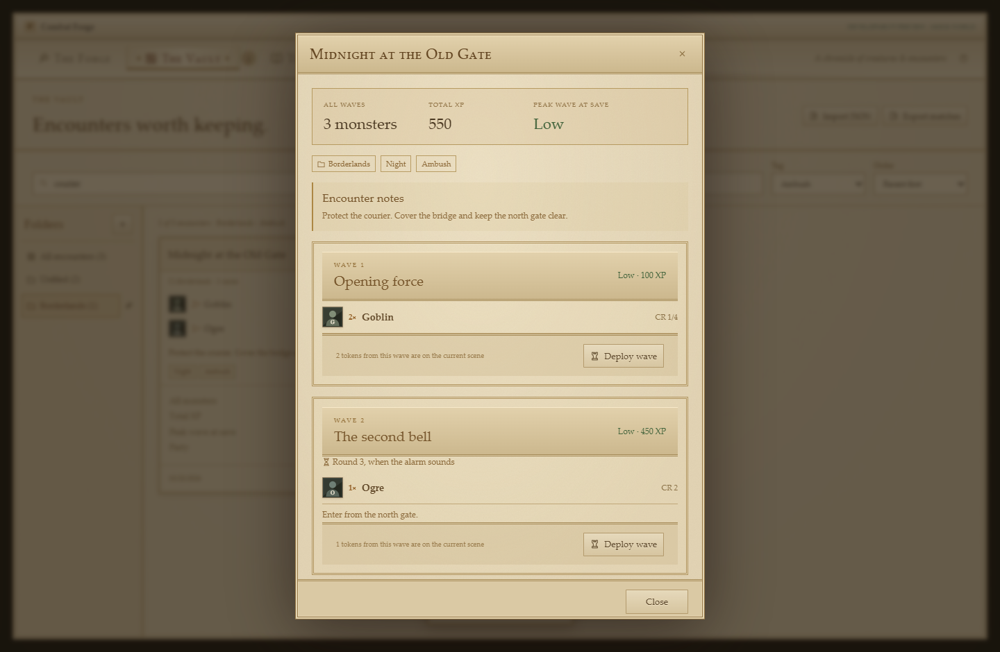
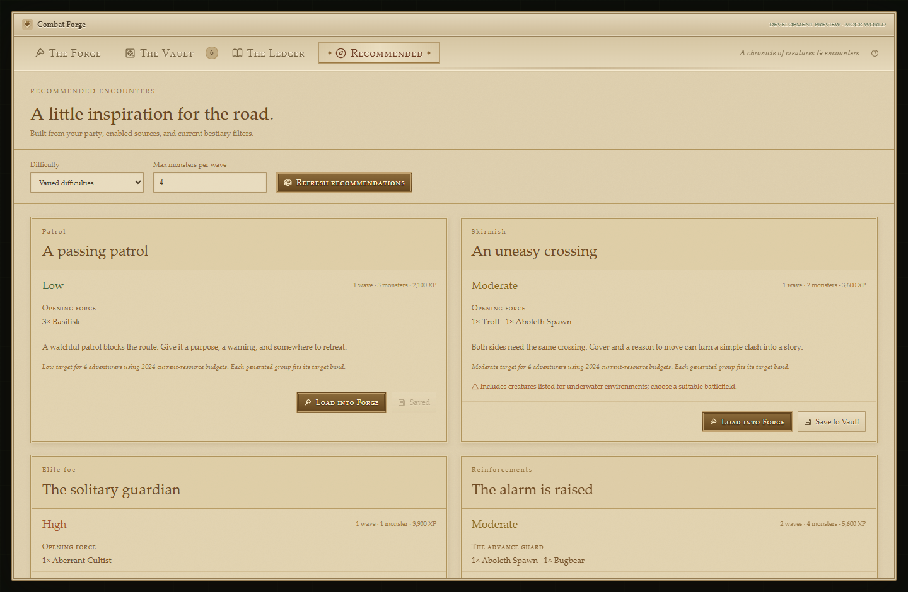
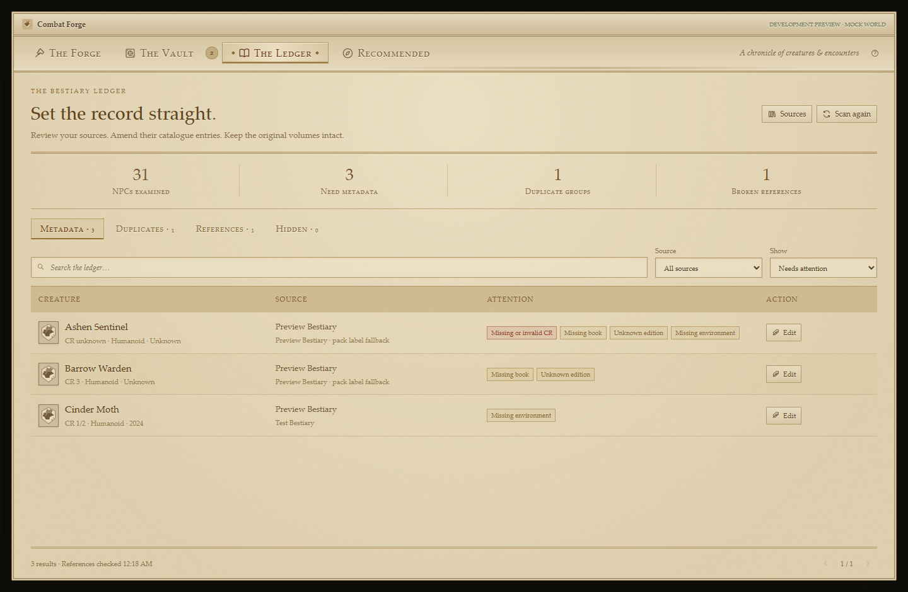
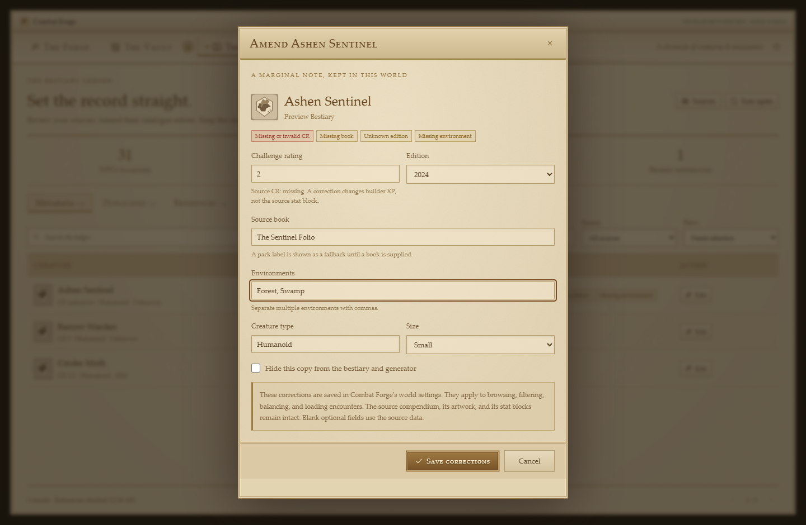

# Combat Forge

A Foundry Virtual Tabletop **V14** encounter builder for the **D&D5e** game system. Browse installed monsters, balance encounters against your party's current state, keep fights in the Vault, and deploy them to a scene.



<details><summary>Generator, Vault, waves, recommendations, and Ledger previews</summary>








</details>

## Install

In Foundry's **Add-on Modules → Install Module**, paste this manifest URL:

```text
https://github.com/Hierarchs/Combat-Maker/releases/latest/download/module.json
```

Enable **Combat Forge** in your D&D5e world under **Manage Modules**. Use a D&D5e system release compatible with your installed Foundry V14 version.

Open the builder using the **hammer in Token Controls**, the **Combat Forge button in the Actors directory**, **Configure Settings → Module Settings → Combat Forge**, or **Ctrl+Shift+E** (rebindable). It is a GM tool.

For a manual installation, download `combat-maker.zip` from [Releases](https://github.com/Hierarchs/Combat-Maker/releases), extract its `combat-maker` directory into `Data/modules/`, then restart Foundry. `module.json` must be at `Data/modules/combat-maker/module.json`.

## The Forge

The workspace uses an original parchment-and-ink theme inspired by the classic Oblivion menus: serif type, fine gold borders, engraved controls, and warm paper panels. The layout keeps your party at upper left, encounter and difficulty below, and a searchable monster browser on the right. The Forge, Vault, Ledger, and dialogs share the theme. All textures and ornaments are original SVG/CSS artwork; no game assets or external fonts are required.

1. **Choose a party.** Use the person button or drag character Actors or character tokens into the window. Assigned player characters populate the initial party automatically. Health and resource estimates update when actors, items, effects, or tokens change.
2. **Choose sources.** The books button discovers installed Actor compendiums automatically, or lets you check individual packs, including world and homebrew compendiums. World NPCs are included by default. Indexes load two packs at a time. Full actors are fetched for sheets, uncatalogued encounter sources, drops, deployment, and the Ledger's reference scan; scanning references loads only the actors used by encounters or extra dropped references.
3. **Find monsters.** Search names and books; filter by type, size, book, edition, alignment, environment, legendary status, and fractional CR. Sort columns and page through large catalogues. The eye opens a creature's sheet. Click a row, or focus it and press Enter/Space, to add it. Press `/` inside the window to search.
4. **Build or generate.** Adjust quantities directly or with +/−. The generator targets either party difficulty or **combined CR**, respects bestiary filters, and caps both total monsters and distinct stat blocks. It reports when only a closest match is available. Generation replaces only the active wave's monster list, keeping other waves and encounter notes.
5. **Read the rating.** Compare the rested party's **Full** rating with the live **Now** estimate. Click the difficulty panel to see all budgets and the calculation.
6. **Save or deploy.** Save a named encounter to the Vault, or place it in the current scene.

### Homebrew and compendium support

Any accessible **D&D5e Actor compendium** can be a source, regardless of its publisher or whether it belongs to a world, module, or system. No integrations with individual publishers are required. Only `npc` Actors with valid CR values (0, 1/8, 1/4, 1/2, and integers 1–30) become usable monster entries. Characters and vehicles are skipped. NPCs with missing or invalid CRs remain available for repair in the Ledger. Failures in one pack do not prevent other packs from loading.

Drop an NPC into the monster list to retain its UUID even when its pack is not selected. Dropping a valid NPC into the encounter panel also adds it to the encounter. An invalid CR opens its metadata repair form. The module does not modify your compendium. Use **Forget manually dropped actor references** in Sources to clear these extra references.

Metadata is read from current and legacy D&D5e fields:

| Filter | Source data |
| --- | --- |
| CR / XP | `system.details.cr`; prepared `system.details.xp.value` when present, otherwise the standard CR table |
| Creature type / swarm | `system.details.type` string or `{value, custom, subtype, swarm}` |
| Size | `system.traits.size` |
| Book | `system.source.book/custom`, legacy `system.details.source`, then pack label |
| Edition | `system.source.rules` (`2014`/`2024`), or an explicit year/SRD version in the book label |
| Environment | Modern `system.details.habitat.value[].type/custom`, or legacy `system.details.environment` |
| Alignment | `system.details.alignment` |
| Legendary | `system.resources.legact.max` or `system.resources.legres.max` |

Unknown metadata stays unknown. The module cannot infer a monster's environment or edition reliably when the source does not supply it. Source authors can optionally override book, edition, and environments with `flags.combat-maker.book`, `flags.combat-maker.edition`, and `flags.combat-maker.environments`. Existing monster documents remain editable through their normal actor sheets.

The package supports D&D5e's data model; other game systems' Actor packs require a separate adapter and are not supported.

## The Bestiary Ledger

Open **The Ledger** to examine catalogue health and repair incomplete entries. Use the quill beside any creature in the Forge to open the same metadata editor directly.

- **Metadata:** Lists the exact NPCs with missing/invalid CR, missing book, unknown edition, or missing environment. Filter by issue, source, name, or saved corrections. A pack's label can still be displayed as a fallback, while the Ledger identifies that an explicit book is missing. Invalid NPCs remain in this report even when they cannot appear in the monster browser.
- **Corrections:** Amend CR, book, edition, environments, creature type, and size. Corrections persist in this world's `combat-maker.catalogRepairs` setting and apply to browsing, filters, encounter loading, and balance calculations. Changing CR recalculates builder XP from the CR table. Unchanged CR preserves any explicit source XP. Blank optional fields use source values; **Reset to source metadata** removes all local corrections for that entry, including its hidden preference.
- **Duplicates:** Identifies possible copies with matching name, CR, edition, creature type, and size. Full stat blocks may still differ. Nothing is merged automatically. **Prefer this copy** keeps one visible and hides the others from browsing and generation; the Hidden section can restore any copy. Existing encounters can still load and deploy hidden source actors. Different editions and CRs stay separate.
- **References:** Checks monster UUIDs used by Vault encounters, the current draft, dropped actors, and saved replacement mappings. Missing sources and actors requiring CR repair are shown with their affected encounters. Available actors in unselected packs are checked without enabling the whole pack.
- **Replacement actors:** Search for an available NPC and explicitly map the missing UUID to it. The mapping applies across Combat Forge in this world, including direct deployment from old Vault entries. It does not rewrite source packs or existing Vault journals. Loading refreshes the creature's metadata; re-saving that encounter stores the new UUID and recalculated rating. If an original source returns later, its browser entry remains suppressed while its replacement mapping is active, so selecting a displayed creature always uses that creature. Remove the mapping under References to restore the original. Mappings can be changed or removed, and cyclic mappings are rejected.

Corrections change catalogue metadata, not the source stat block. Deployment continues to use the actual actor's abilities and statistics. Duplicate suppression is also confined to Combat Forge; it never deletes actors or compendium entries. Normal Foundry world backups include corrections and replacement settings. v1.0 Vault journals and drafts remain compatible with v1.1.

## Difficulty rules

Choose the sliders button to switch encounter rules and the optional estimates independently of each monster's edition.

**2014 official DMG:** Adds each character's level-based Easy/Medium/Hard/Deadly thresholds. Raw XP is multiplied by the standard monster-count ladder, shifted for parties below three or above five characters. The displayed rating is the highest reached threshold. All selected monsters are assumed to contribute meaningfully to the encounter. Awarded XP stays separate from adjusted XP.

**2024 official DMG:** Uses the level-based Low/Moderate/High XP budget **ceilings**, with no official monster-count multiplier. XP at or below the Low budget is Low; above Low through Moderate is Moderate; above Moderate through High is High. Exceeding High is marked **Over budget** as a module advisory, not an additional official category.

**Adjusted swarms (optional house rule):** Uses the 2014 monster-count multiplier ladder in either edition. Creatures worth less than 10% of the strongest creature's XP add their XP but do not increase the count used for that multiplier. This is a documented, deterministic interpretation of weak enemies for large groups; it is not an official WotC rule, and does not change stat blocks or the XP awarded. You may leave it disabled.

**Dynamic party capacity (optional house estimate):** Scales each character's budget before comparing difficulty. The Full rating always uses unmodified level budgets.

- HP loss removes up to 60% of capacity; temporary HP counts up to the maximum HP cap.
- Weighted spell-slot depletion removes up to 30%, scaled by spellcasting-class levels divided by total level. Full, half, third, artificer, and pact progressions are handled. Higher-level slots have proportionately more weight.
- Depleted tracked resources and limited-use feat items remove up to 10%. Modern item `spent` and older `value` storage are supported.
- Exhaustion reduces the remainder by 8% per level, to a 40% factor. Other than incapacitation, final capacity is bounded between 10% and 100%.
- Zero HP, dead, unconscious, incapacitated, or petrified characters contribute no current capacity. Missing resource pools are treated as full.

This model is advisory and cannot know tactics, custom automation, magic-item power, untracked class abilities, terrain, or every special ability. High monster CR relative to party level is flagged. Disable dynamic capacity for the full-strength official rating.

## The Vault

Saved encounters are individual **JournalEntry documents** in **Combat Forge — The Vault**, with GM-only default ownership. They include all waves, monster references and metadata, quantities, party snapshots and references, rule choices, tags, folder, encounter notes, save date, and per-wave difficulty at save. No commercial stat blocks are copied into the Vault.

- Search names, creature names, tags, encounter notes, wave names, wave notes, and arrival triggers. Folder and tag filters combine with search. Sort by recency, name, or total XP; larger libraries are paged.
- Enter comma-separated tags, a folder, and notes in the Save dialog. The book button beside the active wave also edits encounter notes while building.
- Create folders with the + beside Folders. The quill beside a folder renames it or offers deletion. These are real JournalEntry folders under the Vault root. Removing a folder moves its encounters to Unfiled and keeps them. Folders containing unrelated journals or manually added subfolders must be cleared first.
- Click a card's name to inspect encounter notes, every wave, its saved rating, and the saved party.
- **Load into Forge** refreshes actor data and party resources so you can edit a previous fight. **Save** updates that encounter; **Save as a new encounter** creates a copy.
- **Deploy** works directly from a card or its detail view. Multi-wave cards ask which group to deploy; each group also has its own deployment button in the detail view.
- Cards show total monsters and XP across all waves, plus the **peak wave** rating. This rating is not a claim that the entire sequence has that difficulty.
- **Export matches** downloads the encounters matching the current search/folder/tag filters. Each card and detail view can export one encounter. Exports include wave plans, notes, tags, folder names, party snapshots, and actor UUIDs; they do not include source Actor documents or stat blocks.
- **Import JSON** accepts a file or pasted export and previews names, waves, monster totals, and folders before importing. Imports create new copies, never overwrite existing encounters, and reuse matching folder names. The format is versioned and validated; limits are 5 MB and 100 encounters per import. If a write fails, newly imported encounter journals are rolled back where possible; empty folders may remain.
- When a saved source is missing or has an invalid CR, loading or deployment opens a **Repair encounter sources** dialog. Choose replacements or repair CR through the Ledger. No partial deployment occurs while a source is unresolved. Replacement mappings also work for imported UUIDs from another world; matching actors are never guessed automatically.
- Deleting a Vault entry deletes that encounter's journal, leaving its actors and scene tokens in place.

The current draft is saved per client in Foundry settings. World sources, dropped homebrew references, and default rules are world settings. Normal Foundry world backups include the Vault journals and world settings. Each encounter has its own document, so two GMs saving different encounters do not overwrite a shared list. Concurrent edits to the same encounter follow Foundry's normal document update behavior.

## Waves and reinforcements

Use the wave selector above the encounter's monster list to switch groups. The + creates a wave; the quill edits its name, arrival trigger, notes, and order, or deletes it. Add creatures and use the generator with the intended wave selected. Switching waves preserves every group's list. Save stores the entire encounter, including empty planning waves.

Each wave has its own XP/difficulty calculation against the party's current state. The Forge summary rates the **active wave**. The Vault records each wave's rating and the peak rating at save. Parties can lose resources between waves, and overlapping groups can be more dangerous than separate ratings suggest. Written arrival triggers are GM notes: they do not automatically spawn tokens or advance combat.

Deploy each group from the Forge, a Vault card, or the saved detail view. Optionally check **Roll initiative for this group**; this also adds it to the current scene's combat, creating one if needed. Only the new group's combatants are rolled. Existing initiatives stay intact, and Foundry keeps the current combatant on their turn. Hidden groups use V14's private GM message mode. Visible groups use the normal message visibility setting.

Tokens carry encounter/wave flags so the saved detail view can show how many tokens from that wave remain on the viewed scene. Deploying a group again explicitly adds another copy; the dialog shows the existing count. Token flags track presence, not a permanent combat history.

Limits are **10 waves**, **100 monsters per wave/deployment**, and **500 monsters across an encounter**. Schema-1 encounters from v1.0/v1.1 are upgraded to one opening wave in memory; their journals are only rewritten when you save. v1.2 exports use schema 2 and require a module version that understands waves.

## Recommended encounters

Open **Recommended** after choosing a party. The module generates four encounter plans from enabled catalogue sources and the bestiary's current search/filter choices: a patrol, a skirmish, a solitary elite foe, and a two-wave reinforcement encounter. Choose varied difficulties or one desired difficulty, cap the number of monsters per wave, and refresh for new options.

Every plan shows its actual rating, creatures, XP, story hook, target-fit explanation, and relevant cautions. Only real indexed monster references are used. If restrictions prevent the requested budget from being reached, the card says it is the closest available match. Recommendations account for your selected rules and optional current-resource estimate; they do not simulate tactics, ability synergies, or future resource expenditure. Aquatic metadata and high-CR threats receive cautions where detected.

**Load into Forge** opens a plan for customization, replacing the current draft's groups. **Save to Vault** saves it as a new encounter without changing the draft. Reinforcement plans retain separate arrival notes and waves. A **From your Vault** section ranks saved encounters by how close their peak wave is to the requested party budget, using current party state and bestiary filters. Loading a saved encounter restores its own rule selection and refreshes its actor data.

If the party, rules, source count, or bestiary filters change, a message asks you to refresh the displayed plans. The suggestions are a preparation aid; review special abilities, terrain, source availability, and wave timing before using them.

## Deployment

Open a scene and choose a point or the center of the current view for one wave. Hidden tokens are the default; optionally add the group to the scene's active combat and roll its initiative.

Compendium Actors are imported once, tagged by source UUID, and reused on subsequent deployments. Imported world Actors can be edited normally; later deployments use those edited copies. Tokens are unlinked, hostile, and preserve prototype artwork, wildcard selection, and size. Placement snaps with Foundry's token API and avoids token footprint overlaps within scene bounds, including larger tokens. Wall, region, terrain, and elevation suitability still need GM review. At most 100 monsters are deployed in one group.

Every source is resolved before deployment starts. Missing sources stop the operation with an actionable error. Failed deployment attempts roll back created tokens, newly created combats, and unused imports where possible. If a cleanup operation itself fails, the module reports it so the scene can be checked.

## Development

No build step is required to load the source module in Foundry. For tests and distributable packaging, use Node.js 22 or later:

```sh
npm ci
npm run check
npm test
npm run test:browser
npm run build
```

`npm run test:browser` uses an installed Chrome browser by default. Set `CF_BROWSER_CHANNEL` to an installed Playwright-supported channel, or install Chrome. The development preview uses **mock Foundry documents**, not your world:

```sh
npm run preview
# Open http://127.0.0.1:4314
```

Automated coverage includes official rules examples and boundaries, dynamic readiness, legacy/current metadata, constrained generation, source diagnostics/repair and immutability, duplicate preferences, independent Vault saves, wave-schema migration and limits, search/filter intersections, native folders, JSON round trips and import rollback, separate wave deployment, per-group initiative and failure cleanup, recommendations, browser workflows, and compact layouts. Browser fixtures exercise the actual controller and views using a mock adapter. **A live Foundry V14/D&D5e world smoke test is still required for runtime certification.** See [docs/TESTING.md](docs/TESTING.md).

The package uses V14 `ApplicationV2`, the current scene-control record format, namespaced document APIs, UUIDs, compendium indexes, and token snapping. It does not embed the VTT or system runtime. The production ZIP excludes tests, development fixtures, dependencies, and development servers.

## Releases

v1.3.0 optimizes catalogue queries, Vault snapshots, redraws, resource hooks, encounter generation, and crowded-scene placement. With 10,026 monsters and 500 saved encounters in the local mock-world benchmark, warm Forge redraws fell from 23.7 to 1.2 ms. The parchment theme and existing features are preserved; no new settings are required. See [performance measurements, cache behavior, and reproduction commands](docs/PERFORMANCE.md). These measurements do not replace live Foundry world testing.

The GitHub Actions release workflow checks, tests, packages, and publishes `combat-maker.zip` and `module.json` when a `v*` tag is pushed. The tag must match the manifest and package version. Update `module.json`'s download URL with each version, then push the tag. The stable installation URL always points to the latest release's manifest.

## References and license

- [Foundry V14 API](https://foundryvtt.com/api/v14/)
- [Official D&D5e system source](https://github.com/foundryvtt/dnd5e)
- [2014 encounter rules](https://www.dndbeyond.com/sources/dnd/basic-rules-2014/building-combat-encounters)
- [2024 encounter rules](https://www.dndbeyond.com/sources/dnd/br-2024/dms-toolbox)
- [MIT software license](LICENSE) and [SRD attribution](THIRD_PARTY.md)

No monster content is bundled. Your installed compendiums supply the creatures and artwork.
